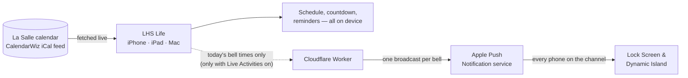

<h1 align="center">LHS Life</h1>

  <b>Hey La Salle, one app for it all.</b> 
  Bells, events, lunch, grades and assignments for La Salle High School, Yakima.

  
  
  

  
  
  

---

## What is this?

This is the source for **LHS Life**, the student-built companion app for La Salle High School. It turns the school's official calendar into a live bell schedule, puts lunch ordering, grades and Schoology a tap away, and reminds you about the things that are easy to forget — all from one app on your iPhone, iPad or Mac.

It's free on the App Store, built for the 2026–27 school year, and made by a La Salle student for La Salle students.

## What it does

| | |
|---|---|
| 🔔 **Never miss a bell** | The header counts down your class in real time — *"22 min left in Calculus BC"* — and the same countdown can live on your Lock Screen and Dynamic Island. Every day, only on unusual days, or never: your call. |
| 📅 **The whole school calendar** | Day, month and year views of every event, game, Mass and schedule change, pulled live from the official calendar. Late starts, rallies and liturgy days just work — even when the schedule was posted as a picture. |
| 🍴 **Lunch, grades, Schoology** | Lunch ordering, PowerSchool and Schoology live right inside the app. Sign in once and stay signed in. |
| 📚 **Homework in a tap** | Add an assignment from anywhere. It's tagged with the class you're sitting in and saved to Apple Reminders. |
| ⏰ **Reminders that matter** | Professional Dress and Late Start alerts at the time you choose — the night before or that morning — plus Student Store and announcement reminders for ASB. |
| 🎨 **Make it yours** | Name and color your classes, hide the periods you don't have, and pick which alerts reach which device. |
| 🗣️ **Siri & Shortcuts** | *"How much time is left in class in LHS Life?"* · *"What's my next class in LHS Life?"* · *"Add homework in LHS Life."* |

## On iPad and Mac

  
  
  

On iPad, LHS Life spreads out into a sidebar layout with the day's countdown always in view. The same app runs on Apple silicon Macs straight from the App Store.

---

## How it works

**LHS Life is self-contained.** Everything you see is worked out on your device from the school's public calendar. There are no accounts, no analytics, and no LHS Life server standing between you and your schedule. The one exception is optional: a small Cloudflare server that keeps Live Activities ticking on your Lock Screen.

### 1 · The app does the work

- **Live from the source.** The app reads the same CalendarWiz calendar the school publishes. It fetches it when you open the app, every time you come back to it, and when you pull down on the day view — so a schedule change reaches you the next time you look.
- **Schedules, however they're posted.** Bell times arrive in more than one format, and LHS Life reads them all: stacked tables, one row per line (*"8:00 — 8:40 ..... First Period"*), and — when a schedule is only posted as an image — the picture itself, read with Apple's on-device text recognition. Days with no posted times fall back to the standard schedule for that kind of day.
- **Yours stays yours.** Your classes, colors and graduation year are stored on your device and synced between your own devices through *your* iCloud account. Alert settings stay on each device, so reminders go to the phone in your pocket and not also to your Mac.
- **Reminders are local.** Every notification is scheduled on the device itself — nothing is pushed from a server except Live Activity updates.

### 2 · The server keeps the Lock Screen live

A Live Activity can't wake itself up at 8:50 to say "next period". So when you turn Live Activities on, the app tells a small **Cloudflare Worker** one thing: your bell times for the day. The Worker keeps each different schedule once. A cron job runs every minute through the school day and, at each bell in any of today's schedules, sends **one** update to an Apple **broadcast channel** (iOS 18). Apple delivers it to every phone listening, and each card works out its own class from the schedule it already carries. After the day's last bell, one more broadcast clears every card.

- **Anonymous by design.** The Worker never learns who is listening — no device ID, no push token, nothing about the phone. Only the bell times.
- **No phone limit.** One push per bell for the whole school. Forty phones or the whole school cost the same, and it fits Cloudflare's free plan.
- **A status page.** When something breaks in a way the school can fix — the calendar is unreachable, a schedule picture can't be read, a school site won't load — the app reports it once a day, and the Worker's `/status` page shows each problem with a count of affected devices.

---

## Repo map

| Path | What's inside |
|---|---|
| `LHS Life/` | The app: SwiftUI views, schedule parsing, notifications, Live Activity logic, Siri intents |
| `LHS Widgets/` | The Live Activity's Lock Screen and Dynamic Island UI |
| `APNS Worker.json` | The Cloudflare Worker (it's JavaScript, despite the name) — its header explains every page and variable |
| `LHS LifeTests/` | Unit tests for schedule parsing and the schedule engine |
| `Docs/` | Architecture notes, requirements and test plans |
| `App Icons/` | The Icon Composer files for Classic and the holiday icons, plus their source artwork |
| `App Store Content/` | App Store screenshots, demo video and support images |
| `Marketing/` | Posters and promo video |

## Building it

1. **Xcode 26 or later.** Open `LHS Life.xcodeproj` and run the **LHS Life** scheme. The app targets iOS 17; Live Activities need iOS 18.
2. **Signing.** The app, widget extension and the `group.lasalleyakima.lhslife` App Group are set up under the school's Apple Developer team.

**Handy debug tools** (debug builds only):

| | |
|---|---|
| `-demoClock "2026-10-12 10:12"` | Launches with a running fake clock — great for screen recordings of the countdown |
| `-screenshotDemo` | Starts a believable mid-class Live Activity for screenshots, without touching the server |
| Settings → Debug | Force header text, start test Live Activities |

## Running the server

The Worker is a single file. Paste `APNS Worker.json` into a Cloudflare Worker, bind a KV namespace as `TOKENS`, add a cron trigger that runs every minute (the Worker itself only acts Monday to Friday, 6 AM–5 PM Pacific), and set these variables:

| Variable | What it is |
|---|---|
| `APNS_KEY_ID`, `APNS_TEAM_ID`, `APNS_BUNDLE_ID` | From Apple Developer |
| `APNS_PRIVATE_KEY` | The Apple push-notification key, pasted in full |
| `CLIENT_SECRET` | Must match `AppConstants.workerSecret` in the app. Only the app's own requests use it. Don't change it on its own: phones stop reporting until an app update carries the new value |
| `DASHBOARD_PASSWORD` | The password for the pages below. Change it any time; that signs every browser out and doesn't affect phones. Until it's set, `CLIENT_SECRET` stands in and the dashboard shows a warning |

**Updating it.** Paste the new `APNS Worker.json` into the Worker's editor in the Cloudflare dashboard and click **Deploy**. The KV binding, cron and variables stay as they are.

**Broadcast channels.** The app and the Worker share two channel IDs: one for production (App Store and TestFlight builds) and one for sandbox (builds run from Xcode). Every bell goes to both. The IDs are not secrets; they live in `AppConstants.swift` and at the top of the Worker's broadcast section. The **Broadcast Capability** is turned on for the app's App ID in Apple Developer. **Never turn it off: doing so permanently deletes every channel**, and every phone would need an app update to listen again.

Then open these in a browser. The first visit shows a sign-in page (the password is `DASHBOARD_PASSWORD`), and that browser stays signed in for a year; `/logout` signs it out. Scripts can send Basic auth or an `X-LHS-Auth` header instead.

- **`/health`** — no sign-in. Says whether the latest bell's broadcast went out: `broadcast: ok, last 08:55` or `broadcast: FAILED …`. Point a free uptime monitor at it and alert when it says FAILED.
- **`/status`** — a dashboard with charts: whether each of today's bells went out, how long Apple took, problem reports from the past week, and the phones still on 1.2.0 or earlier. Dropdowns pick the day (up to 3 back), a schedule, and which problems to show. The same data is at `/status.json?day=yyyy-MM-dd` for scripts.
- **`/test-broadcast`** — sends one broadcast now and explains, in plain English, what Apple said. Sandbox by default; `?env=production` or `?env=both` for the real channel. `&end=1` clears every card, and on production also needs `&confirm=yes`.

How many phones are listening is in Apple's Push Notifications Console (Overview → subscriptions), for production builds only. The Worker doesn't know.

**Tests.** `./Worker\ Tests/run.sh` runs the Worker's tests (see `Docs/TESTS.md`).

**Retired: one push per phone.** Versions 1.2.0 and earlier registered each phone for pushes of its own. That system was removed in October 2026, once no phone was left on it; `/register` and `/unregister` now answer 410. If the KV namespace still has `registry:devices` or `capacity:observed`, or the Worker still has `SUBREQUEST_BUDGET` or `MAX_DEVICES` set, they're unused and can be deleted.

## Privacy

LHS Life keeps as much as possible on your device: no accounts, no tracking, no ads. The full policy — including exactly what the Live Activity server sees and how long it keeps it — is in [`PRIVACY.md`](LHS%20Life/Resources/PRIVACY.md) and inside the app under **Settings → Privacy Policy**.

---

## Spread the word

  

  An 8.5 × 11 poster, ready to print — <a href="Marketing/LHS%20Life%20Poster.pdf">PDF</a> · <a href="Marketing/LHS%20Life%20Poster.png">PNG</a>. 
  The QR code opens LHS Life on the App Store.

---

<i>Made by L Lefohn, Class of 2027, for La Salle High School.</i>

