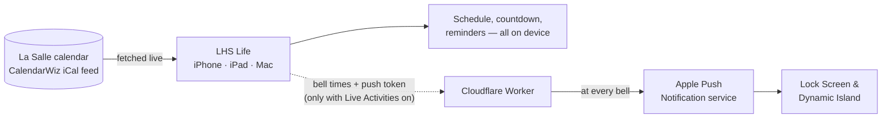

  
  
  

<h1 align="center">LHS Life</h1>

  <b>Hey La Salle, one app for it all.</b> 
  Bells, events, lunch, grades and assignments for La Salle High School, Yakima.

  
  
  

---

## What is this?

This is the source for **LHS Life**, the student-built companion app for La Salle High School. It turns the school's official calendar into a live bell schedule, puts lunch ordering, grades and Schoology a tap away, and reminds you about the things that are easy to forget — all from one app on your iPhone, iPad or Mac.

It's free on the App Store, built for the 2026–27 school year, and made by a La Salle student for La Salle students.

## What it does

| | |
|---|---|
| 🔔 **Never miss a bell** | The header counts down your class in real time — *"22 min left in Calculus BC"* — and the same countdown can live on your Lock Screen and Dynamic Island. Every day, only on unusual days, or never: your call. |
| 📅 **The whole school calendar** | Day, month and year views of every event, game, Mass and schedule change, pulled live from the official calendar. Late starts, rallies and liturgy days just work — even when the schedule was posted as a picture. |
| 🍴 **Lunch, grades, Schoology** | Lunch ordering, PowerSchool and Schoology live right inside the app. Sign in once and stay signed in. |
| 📚 **Homework in a tap** | Add an assignment from anywhere. It's tagged with the class you're sitting in and saved to Apple Reminders. |
| ⏰ **Reminders that matter** | Professional Dress and Late Start alerts at the time you choose — the night before or that morning — plus Student Store and announcement reminders for ASB. |
| 🎨 **Make it yours** | Name and color your classes, hide the periods you don't have, and pick which alerts reach which device. |
| 🗣️ **Siri & Shortcuts** | *"How much time is left in class in LHS Life?"* · *"What's my next class in LHS Life?"* · *"Add homework in LHS Life."* |

## On iPad and Mac

  
  
  

On iPad, LHS Life spreads out into a sidebar layout with the day's countdown always in view. The same app runs on Apple silicon Macs straight from the App Store.

---

## How it works

**LHS Life is self-contained.** Everything you see is worked out on your device from the school's public calendar. There are no accounts, no analytics, and no LHS Life server standing between you and your schedule. The one exception is optional: a small Cloudflare server that keeps Live Activities ticking on your Lock Screen.

### 1 · The app does the work

- **Live from the source.** The app reads the same CalendarWiz calendar the school publishes. It fetches it when you open the app, every time you come back to it, and when you pull down on the day view — so a schedule change reaches you the next time you look.
- **Schedules, however they're posted.** Bell times arrive in more than one format, and LHS Life reads them all: stacked tables, one row per line (*"8:00 — 8:40 ..... First Period"*), and — when a schedule is only posted as an image — the picture itself, read with Apple's on-device text recognition. Days with no posted times fall back to the standard schedule for that kind of day.
- **Yours stays yours.** Your classes, colors and graduation year are stored on your device and synced between your own devices through *your* iCloud account. Alert settings stay on each device, so reminders go to the phone in your pocket and not also to your Mac.
- **Reminders are local.** Every notification is scheduled on the device itself — nothing is pushed from a server except Live Activity updates.

### 2 · The server keeps the Lock Screen live

A Live Activity can't wake itself up at 8:50 to say "next period". So when you turn Live Activities on, the app tells a small **Cloudflare Worker** two things: your bell times for the day and an anonymous push token. A cron job runs every minute through the school day and, at each bell, sends an update through Apple's push service; at the last bell it dismisses the card.

- **Anonymous by design.** The Worker never learns who you are — just a random device ID, the bell times, the app build and the iOS version.
- **Capacity.** On Cloudflare's free plan the Worker serves about 40 phones and tells anyone beyond that, politely, that it's full. On the paid plan, two variables lift the limit to the whole school (see [Running the server](#running-the-server)).
- **A status page.** When something breaks in a way the school can fix — the calendar is unreachable, a schedule picture can't be read, a school site won't load — the app reports it once a day, and the Worker's `/status` page shows each problem with a count of affected devices.

---

## Repo map

| Path | What's inside |
|---|---|
| `LHS Life/` | The app: SwiftUI views, schedule parsing, notifications, Live Activity logic, Siri intents |
| `LHS Widgets/` | The Live Activity's Lock Screen and Dynamic Island UI |
| `APNS Worker.json` | The Cloudflare Worker (it's JavaScript, despite the name) — its header explains every page and variable |
| `LHS LifeTests/` | Unit tests for schedule parsing and the schedule engine |
| `Docs/` | Architecture notes, requirements and test plans |
| `App Store Content/` | App Store screenshots, demo video and support images |
| `Marketing/` | Posters and promo video |

## Building it

1. **Xcode 26 or later.** Open `LHS Life.xcodeproj` and run the **LHS Life** scheme. The app targets iOS 17; Live Activities need iOS 18.
2. **Signing.** The app, widget extension and the `group.lasalleyakima.lhslife` App Group are set up under the school's Apple Developer team.
3. **Secrets stay out of git.** The Apple push key (`AuthKey_*.p8`) is ignored by `.gitignore` and lives only in the Worker's Cloudflare variables. Never commit it.

**Handy debug tools** (debug builds only):

| | |
|---|---|
| `-demoClock "2026-10-12 10:12"` | Launches with a running fake clock — great for screen recordings of the countdown |
| `-screenshotDemo` | Starts a believable mid-class Live Activity for screenshots, without touching the server |
| Settings → Debug | Force header text, start test Live Activities, simulate a full server |

## Running the server

The Worker is a single file. Paste `APNS Worker.json` into a Cloudflare Worker, bind a KV namespace as `TOKENS`, add a cron trigger that runs every minute, and set these variables:

| Variable | What it is |
|---|---|
| `APNS_KEY_ID`, `APNS_TEAM_ID`, `APNS_BUNDLE_ID` | From Apple Developer |
| `APNS_PRIVATE_KEY` | The full contents of the `.p8` push key |
| `CLIENT_SECRET` | Must match `AppConstants.workerSecret` in the app; also the password for the pages below |
| `MAX_DEVICES` | *Optional.* How many phones to accept (default 40) |
| `SUBREQUEST_BUDGET` | *Optional.* Requests one bell may spend (default 45, the free plan's ceiling) |

**Moving to the Workers Paid plan?** Set `SUBREQUEST_BUDGET` to about `900` and `MAX_DEVICES` to the number of phones you want to serve. Both are needed: the budget lets each bell reach every phone, and `MAX_DEVICES` lets more phones sign up.

Then open these in a browser (any username, `CLIENT_SECRET` as the password):

- **`/health`** — is it alive? (no sign-in)
- **`/status`** — today's problems and every registered device · add **`?full=1`** for the past week and exact bell times
- **`/test-push`** — sends one update and explains, in plain English, what Apple said

## Privacy

LHS Life keeps as much as possible on your device: no accounts, no tracking, no ads. The full policy — including exactly what the Live Activity server sees and how long it keeps it — is in [`PRIVACY.md`](LHS%20Life/Resources/PRIVACY.md) and inside the app under **Settings → Privacy Policy**.

---

## Spread the word

  

  An 8.5 × 11 poster, ready to print — <a href="Marketing/LHS%20Life%20Poster.pdf">PDF</a> · <a href="Marketing/LHS%20Life%20Poster.png">PNG</a>. 
  The QR code opens LHS Life on the App Store.

---

<i>Made by L Lefohn, Class of 2027, for La Salle High School.</i>

